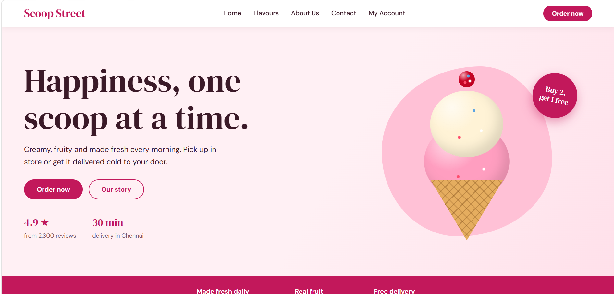
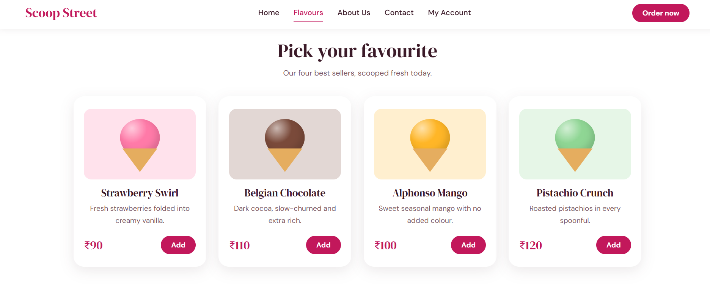
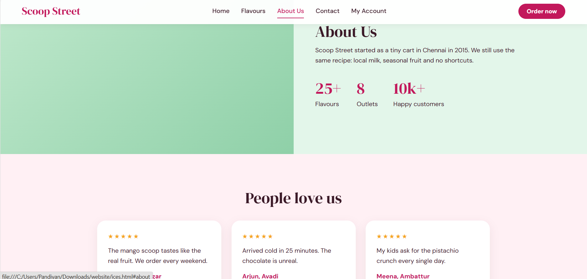
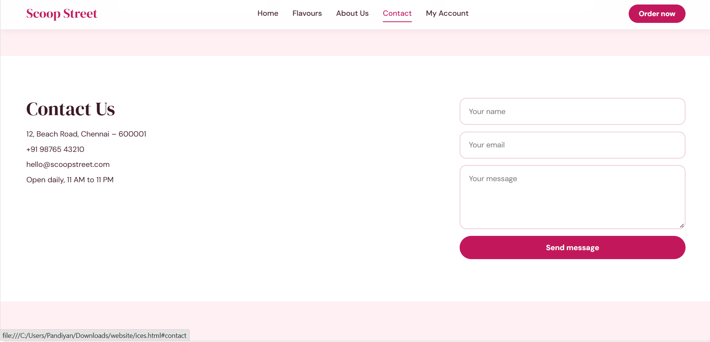
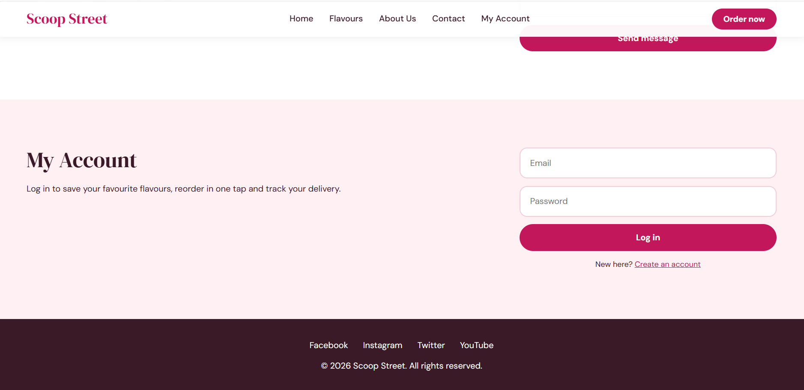

# Ex02 Commercial Website
## Date:02.11.2026

## AIM
To create a commercial website using CSS Flexbox.

## ALGORITHM
### STEP 1
Create an HTML file (index.html)

### STEP 2
Create a CSS file (style.css)

### STEP 3
Include a navigation bar with links to different sections.

### STEP 4
Add structured sections for Homepage, Products / Services, About Us, Contact Details and User Account.

### STEP 5
Include social media links at the footer with copyright information.

### STEP 6
Define global styles for fonts, colors, and layout.

### STEP 7
Style the header, navigation bar, and sections.

### STEP 8
Use Flexbox for layout design.

### STEP 9
Add hover effects and transitions for interactivity.

### STEP 10
Add Images and Media.

### STEP 11
Use optimized images for a professional look.

### STEP 12
Open the HTML file in a browser to check layout and functionality.

### STEP 13
Fix styling issues and refine content placement.

### STEP 14
Deploy the website.

### STEP 15
Upload to GitHub Pages for free hosting.

## PROGRAM
HTML
```
<!DOCTYPE html>
<html lang="en">
<head>
  <meta charset="UTF-8">
  <meta name="viewport" content="width=device-width, initial-scale=1.0">
  <title>Scoop Street – Fresh Ice Cream, Delivered</title>
  <link rel="preconnect" href="https://fonts.googleapis.com">
  <link rel="preconnect" href="https://fonts.gstatic.com" crossorigin>
  <link href="https://fonts.googleapis.com/css2?family=DM+Serif+Display&family=DM+Sans:wght@400;500;700&display=swap" rel="stylesheet">
  <link rel="stylesheet" href="ice.css">
</head>
<body>

  <header class="header">
    <a href="#home" class="logo">Scoop Street</a>
    <nav class="nav">
      <a href="#home">Home</a>
      <a href="#products">Flavours</a>
      <a href="#about">About Us</a>
      <a href="#contact">Contact</a>
      <a href="#account">My Account</a>
    </nav>
    <a href="#products" class="btn small-btn">Order now</a>
  </header>

  <!-- HOMEPAGE -->
  <section id="home" class="hero">
    <div class="hero-text">
      <h1>Happiness, one scoop at a time.</h1>
      <p>Creamy, fruity and made fresh every morning. Pick up in store or get it delivered cold to your door.</p>
      <div class="hero-actions">
        <a href="#products" class="btn">Order now</a>
        <a href="#about" class="btn ghost">Our story</a>
      </div>
      <div class="proof">
        <div><strong>4.9 ★</strong><span>from 2,300 reviews</span></div>
        <div><strong>30 min</strong><span>delivery in Chennai</span></div>
      </div>
    </div>
    <div class="hero-visual">
      <div class="blob"></div>
      <div class="cone" aria-hidden="true">
        <div class="ball b1"></div>
        <div class="ball b2"></div>
        <div class="ball b3"></div>
        <div class="wafer"></div>
      </div>
      <div class="badge">Buy 2,<br>get 1 free</div>
    </div>
  </section>

  <!-- PERKS -->
  <section class="perks">
    <div class="perk"><strong>Made fresh daily</strong><span>Churned every morning</span></div>
    <div class="perk"><strong>Real fruit</strong><span>No artificial colours</span></div>
    <div class="perk"><strong>Free delivery</strong><span>On orders above ₹300</span></div>
  </section>

  <!-- PRODUCTS / SERVICES -->
  <section id="products" class="section">
    <h2>Pick your favourite</h2>
    <p class="lead">Our four best sellers, scooped fresh today.</p>
    <div class="cards">
      <div class="card" style="--c:#ff7aa8">
        <div class="art"><div class="scoop"></div><div class="cup"></div></div>
        <h3>Strawberry Swirl</h3>
        <p>Fresh strawberries folded into creamy vanilla.</p>
        <div class="row"><span class="price">₹90</span><button class="btn small-btn">Add</button></div>
      </div>
      <div class="card" style="--c:#7a4a3a">
        <div class="art"><div class="scoop"></div><div class="cup"></div></div>
        <h3>Belgian Chocolate</h3>
        <p>Dark cocoa, slow-churned and extra rich.</p>
        <div class="row"><span class="price">₹110</span><button class="btn small-btn">Add</button></div>
      </div>
      <div class="card" style="--c:#ffb627">
        <div class="art"><div class="scoop"></div><div class="cup"></div></div>
        <h3>Alphonso Mango</h3>
        <p>Sweet seasonal mango with no added colour.</p>
        <div class="row"><span class="price">₹100</span><button class="btn small-btn">Add</button></div>
      </div>
      <div class="card" style="--c:#8fd694">
        <div class="art"><div class="scoop"></div><div class="cup"></div></div>
        <h3>Pistachio Crunch</h3>
        <p>Roasted pistachios in every spoonful.</p>
        <div class="row"><span class="price">₹120</span><button class="btn small-btn">Add</button></div>
      </div>
    </div>
  </section>

  <!-- ABOUT US -->
  <section id="about" class="about">
    <div class="about-photo" role="img" aria-label="Our ice cream kitchen"></div>
    <div class="about-text">
      <h2>About Us</h2>
      <p>Scoop Street started as a tiny cart in Chennai in 2015. We still use the same recipe: local milk, seasonal fruit and no shortcuts.</p>
      <div class="stats">
        <div><strong>25+</strong><span>Flavours</span></div>
        <div><strong>8</strong><span>Outlets</span></div>
        <div><strong>10k+</strong><span>Happy customers</span></div>
      </div>
    </div>
  </section>

  <!-- REVIEWS -->
  <section class="section reviews">
    <h2>People love us</h2>
    <div class="cards">
      <blockquote class="review"><p>The mango scoop tastes like the real fruit. We order every weekend.</p><cite>Priya, Anna Nagar</cite></blockquote>
      <blockquote class="review"><p>Arrived cold in 25 minutes. The chocolate is unreal.</p><cite>Arjun, Avadi</cite></blockquote>
      <blockquote class="review"><p>My kids ask for the pistachio crunch every single day.</p><cite>Meena, Ambattur</cite></blockquote>
    </div>
  </section>

  <!-- CONTACT DETAILS -->
  <section id="contact" class="split">
    <div class="info">
      <h2>Contact Us</h2>
      <p>12, Beach Road, Chennai – 600001</p>
      <p>+91 98765 43210</p>
      <p>hello@scoopstreet.com</p>
      <p>Open daily, 11 AM to 11 PM</p>
    </div>
    <form class="form">
      <input type="text" placeholder="Your name" required>
      <input type="email" placeholder="Your email" required>
      <textarea rows="4" placeholder="Your message"></textarea>
      <button type="submit" class="btn">Send message</button>
    </form>
  </section>

  <!-- USER ACCOUNT -->
  <section id="account" class="split alt">
    <div class="info">
      <h2>My Account</h2>
      <p>Log in to save your favourite flavours, reorder in one tap and track your delivery.</p>
    </div>
    <form class="form">
      <input type="email" placeholder="Email" required>
      <input type="password" placeholder="Password" required>
      <button type="submit" class="btn">Log in</button>
      <p class="note">New here? <a href="#account">Create an account</a></p>
    </form>
  </section>

  <!-- FOOTER -->
  <footer class="footer">
    <div class="social">
      <a href="https://facebook.com">Facebook</a>
      <a href="https://instagram.com">Instagram</a>
      <a href="https://twitter.com">Twitter</a>
      <a href="https://youtube.com">YouTube</a>
    </div>
    <p>&copy; 2026 Scoop Street. All rights reserved.</p>
  </footer>

</body>
</html>
```
CSS
```
/* ---------- GLOBAL ---------- */
:root {
  --berry: #c2185b;
  --berry-dark: #8e0f42;
  --blush: #fff0f4;
  --mint: #e3f6ea;
  --ink: #3b1a28;
  --white: #ffffff;
}
* { margin: 0; padding: 0; box-sizing: border-box; }
html { scroll-behavior: smooth; }
body { font-family: "DM Sans", "Segoe UI", sans-serif; color: var(--ink); background: var(--white); line-height: 1.65; }
a { color: inherit; text-decoration: none; }
h1, h2, h3, .logo { font-family: "DM Serif Display", Georgia, serif; font-weight: 400; line-height: 1.15; }
h2 { font-size: 2.5rem; margin-bottom: 12px; }
h3 { font-size: 1.35rem; }
.lead { margin-bottom: 36px; color: #7a5563; }
:focus-visible { outline: 3px solid var(--berry); outline-offset: 3px; }

.btn { display: inline-block; background: var(--berry); color: var(--white); border: 2px solid var(--berry); padding: 13px 30px; border-radius: 50px; font: 700 1rem "DM Sans", sans-serif; cursor: pointer; transition: background .3s, transform .3s, box-shadow .3s; }
.btn:hover { background: var(--berry-dark); border-color: var(--berry-dark); transform: translateY(-3px); box-shadow: 0 10px 20px rgba(194,24,91,.3); }
.btn.ghost { background: transparent; color: var(--berry); }
.btn.ghost:hover { background: var(--berry); color: var(--white); }
.small-btn { padding: 8px 20px; font-size: .95rem; }

/* ---------- HEADER + NAV ---------- */
.header { display: flex; justify-content: space-between; align-items: center; gap: 20px; padding: 14px 56px; background: rgba(255,255,255,.96); position: sticky; top: 0; z-index: 10; box-shadow: 0 2px 14px rgba(59,26,40,.08); }
.logo { font-size: 1.7rem; color: var(--berry); }
.nav { display: flex; gap: 30px; }
.nav a { font-weight: 500; padding: 4px 0; border-bottom: 2px solid transparent; transition: color .3s, border-color .3s; }
.nav a:hover { color: var(--berry); border-color: var(--berry); }

/* ---------- HERO ---------- */
.hero { display: flex; align-items: center; justify-content: space-between; gap: 40px; padding: 70px 56px; min-height: 84vh; background: linear-gradient(120deg, var(--blush) 55%, #ffe0ea); }
.hero-text { flex: 1.2; }
.hero-text h1 { font-size: clamp(2.8rem, 6vw, 5rem); margin-bottom: 18px; }
.hero-text p { max-width: 480px; font-size: 1.15rem; margin-bottom: 28px; }
.hero-actions { display: flex; gap: 14px; flex-wrap: wrap; margin-bottom: 36px; }
.proof { display: flex; gap: 40px; }
.proof div { display: flex; flex-direction: column; }
.proof strong { font-family: "DM Serif Display", serif; font-size: 1.6rem; color: var(--berry); font-weight: 400; }
.proof span { font-size: .9rem; color: #7a5563; }

.hero-visual { flex: 1; position: relative; display: flex; justify-content: center; align-items: center; min-height: 460px; }
.blob { position: absolute; width: 420px; height: 420px; background: #ffc1d6; border-radius: 58% 42% 55% 45% / 50% 55% 45% 50%; }
.cone { position: relative; width: 240px; height: 440px; }
.ball { position: absolute; left: 50%; border-radius: 50%; transform: translateX(-50%); box-shadow: inset -14px -16px 26px rgba(0,0,0,.12); }
.ball::after { content: ""; position: absolute; inset: 0; border-radius: inherit; background: radial-gradient(circle at 30% 25%, rgba(255,255,255,.65), transparent 35%), radial-gradient(circle at 70% 60%, #fff 0 3px, transparent 4px), radial-gradient(circle at 40% 70%, #ff4d6d 0 3px, transparent 4px), radial-gradient(circle at 60% 30%, #4d9de0 0 3px, transparent 4px); }
.b1 { width: 210px; height: 190px; top: 150px; background: #ff9ec0; }
.b2 { width: 180px; height: 165px; top: 70px; background: #fff3d6; z-index: 2; }
.b3 { width: 40px; height: 40px; top: 22px; background: #d90429; z-index: 3; }
.wafer { position: absolute; left: 50%; top: 290px; width: 180px; height: 150px; transform: translateX(-50%); background-color: #e5ad5f; clip-path: polygon(0 0, 100% 0, 50% 100%); background-image: repeating-linear-gradient(45deg, transparent 0 13px, rgba(120,70,20,.35) 13px 15px), repeating-linear-gradient(-45deg, transparent 0 13px, rgba(120,70,20,.35) 13px 15px); }
.cone:hover .b2 { transform: translateX(-50%) translateY(-6px) rotate(-4deg); transition: transform .4s; }
.badge { position: absolute; right: 6%; top: 8%; width: 110px; height: 110px; display: flex; align-items: center; justify-content: center; text-align: center; background: var(--berry); color: var(--white); font: 400 1.15rem/1.2 "DM Serif Display", serif; border-radius: 50%; transform: rotate(12deg); box-shadow: 0 10px 24px rgba(194,24,91,.4); }

/* ---------- PERKS ---------- */
.perks { display: flex; flex-wrap: wrap; justify-content: center; gap: 20px 70px; padding: 26px 56px; background: var(--berry); color: var(--white); }
.perk { display: flex; flex-direction: column; text-align: center; }
.perk span { font-size: .9rem; opacity: .85; }

/* ---------- PRODUCTS ---------- */
.section { padding: 90px 56px; text-align: center; }
.cards { display: flex; flex-wrap: wrap; gap: 26px; justify-content: center; }
.card { flex: 1 1 230px; max-width: 280px; display: flex; flex-direction: column; gap: 8px; padding: 26px 22px; background: var(--white); border-radius: 22px; box-shadow: 0 8px 28px rgba(59,26,40,.1); text-align: center; transition: transform .3s, box-shadow .3s; }
.card:hover { transform: translateY(-10px); box-shadow: 0 18px 40px rgba(59,26,40,.18); }
.art { position: relative; height: 150px; margin-bottom: 8px; background: color-mix(in srgb, var(--c) 22%, white); border-radius: 16px; }
.scoop { position: absolute; left: 50%; top: 22px; width: 84px; height: 78px; transform: translateX(-50%); border-radius: 50%; background: radial-gradient(circle at 30% 25%, rgba(255,255,255,.6), transparent 38%), var(--c); box-shadow: inset -6px -8px 14px rgba(0,0,0,.14); transition: transform .3s; }
.cup { position: absolute; left: 50%; top: 84px; width: 74px; height: 50px; transform: translateX(-50%); background: #e5ad5f; clip-path: polygon(0 0, 100% 0, 50% 100%); }
.card:hover .scoop { transform: translateX(-50%) translateY(-6px); }
.card p { color: #7a5563; font-size: .95rem; }
.row { display: flex; justify-content: space-between; align-items: center; margin-top: auto; padding-top: 12px; }
.price { font: 400 1.6rem "DM Serif Display", serif; color: var(--berry); }

/* ---------- ABOUT ---------- */
.about { display: flex; flex-wrap: wrap; background: var(--mint); }
.about-photo { flex: 1 1 420px; min-height: 420px; background: url("images/about.jpg") center/cover, linear-gradient(135deg, #bfe8cc, #8fd0a8); }
.about-text { flex: 1 1 420px; padding: 80px 56px; }
.about-text p { max-width: 520px; margin-bottom: 30px; }
.stats { display: flex; gap: 40px; flex-wrap: wrap; }
.stats div { display: flex; flex-direction: column; }
.stats strong { font: 400 2.6rem "DM Serif Display", serif; color: var(--berry); }

/* ---------- REVIEWS ---------- */
.reviews { background: var(--blush); }
.reviews h2 { margin-bottom: 36px; }
.review { flex: 1 1 260px; max-width: 320px; padding: 28px; background: var(--white); border-radius: 22px; text-align: left; box-shadow: 0 8px 24px rgba(59,26,40,.08); }
.review::before { content: "★★★★★"; display: block; color: #f5a623; letter-spacing: 3px; margin-bottom: 10px; }
.review cite { display: block; margin-top: 14px; font-style: normal; font-weight: 700; color: var(--berry); }

/* ---------- CONTACT + ACCOUNT ---------- */
.split { display: flex; flex-wrap: wrap; gap: 50px; align-items: flex-start; padding: 90px 56px; }
.split.alt { background: var(--blush); }
.info { flex: 1 1 300px; display: flex; flex-direction: column; gap: 6px; }
.form { flex: 1 1 340px; max-width: 480px; display: flex; flex-direction: column; gap: 14px; }
input, textarea { padding: 14px 18px; border: 2px solid #f0cdd9; border-radius: 14px; font: inherit; background: var(--white); transition: border-color .3s, box-shadow .3s; }
input:focus, textarea:focus { outline: none; border-color: var(--berry); box-shadow: 0 0 0 4px rgba(194,24,91,.12); }
.note { font-size: .9rem; text-align: center; }
.note a { color: var(--berry); text-decoration: underline; }

/* ---------- FOOTER ---------- */
.footer { display: flex; flex-direction: column; align-items: center; gap: 10px; padding: 36px; background: var(--ink); color: var(--white); }
.social { display: flex; gap: 28px; }
.social a { border-bottom: 2px solid transparent; transition: border-color .3s, color .3s; }
.social a:hover { color: #ff9ec0; border-color: #ff9ec0; }

/* ---------- RESPONSIVE ---------- */
@media (max-width: 860px) {
  .header { flex-wrap: wrap; justify-content: center; padding: 12px 20px; }
  .nav { flex-wrap: wrap; justify-content: center; gap: 16px; order: 3; width: 100%; }
  .hero { flex-direction: column; padding: 50px 24px; text-align: center; }
  .hero-actions, .proof { justify-content: center; }
  .section, .split { padding: 60px 24px; }
  .about-text { padding: 50px 24px; }
}
@media (prefers-reduced-motion: reduce) { * { transition: none !important; } }
```

## OUTPUT






## RESULT
The program for creating commercial website using CSS Flexbox is executed successfully.
